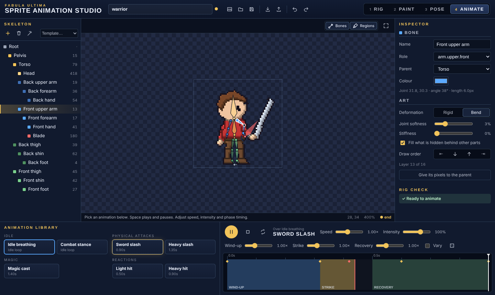

# Fabula Ultima Sprite Animator

2D skeletal animation for character sprites in Foundry VTT v13 (Project FU system). Rig any PNG
or WebP sprite in the **Fabula Ultima — Sprite Animation Studio**, preview reusable animations,
and let actors' tokens play them on the map. Pixel art stays pixel-exact: the original artwork is
never resized, recoloured or repainted.



**Status: Phase 2 prototype.** Tested in Node and headless Chromium (WebGL, PixiJS 7.4.3) and
against a Foundry mock; **not yet run in a real Foundry world** — see
[DEVELOPMENT_STATUS.md](DEVELOPMENT_STATUS.md) and the checklist in [docs/TESTING.md](docs/TESTING.md).

## Install
Add-on Modules → Install Module → Manifest URL:
`https://raw.githubusercontent.com/EclipseGS27/fu-sprite-animator/main/module.json`

Requires Foundry v13 and Project FU 4.14+. Works alongside
[Fabula Ultima Battle Animations](https://github.com/EclipseGS27/fu-animations).

## Quick start
1. Token controls → running-figure button (GM) opens the Studio.
2. **Choose sprite**. A humanoid skeleton is placed on the character.
3. **Rig** (1): drag joints onto shoulders, elbows, hips, knees; the weapon bone along the blade.
4. Press the **wand** to reassign pixels, then **Paint** (2) to fix regions.
5. **Pose** (3): drag limbs to check. **Animate** (4): play the sword slash.
6. **Save**, then **Use this rig for an actor**. Its tokens idle and can act:
   `SpriteAnimator.play(canvas.tokens.controlled[0], 'sword-slash')`.

Full walkthrough: [docs/RIGGING_GUIDE.md](docs/RIGGING_GUIDE.md).

## What's in Phase 2
- Studio: Rig, Paint, Pose and Animate modes; bone tree; inspector; rig check; animation library;
  speed, intensity, per-phase timing and variation; timeline with phases and events; undo/redo;
  save, open, export and import.
- Runtime: bone hierarchy, keyframes with easing, world-angle strikes that work with any rest
  pose, layered tracks, crossfades, events, bending meshes, hidden-region fill, pixel snapping.
- Animations: idle breathing, combat stance, sword slash, heavy slash, magic cast, light hit,
  heavy hit.
- Tokens: animated in place through their texture only, so dashes, flashes and condition tints
  from other modules keep working. Public API and socket sync.

Not yet: automatic combat triggers from abilities (Phase 5), keyframe editing (Phase 4), creature
templates (Phase 6). See [docs/DEVELOPMENT_ROADMAP.md](docs/DEVELOPMENT_ROADMAP.md).

## Documentation
[Project knowledge and research](docs/PROJECT_KNOWLEDGE.md) ·
[Architecture](docs/ARCHITECTURE.md) ·
[Animation format](docs/ANIMATION_FORMAT.md) ·
[Rigging guide](docs/RIGGING_GUIDE.md) ·
[Foundry integration](docs/FOUNDRY_INTEGRATION.md) ·
[API](docs/API.md) ·
[Testing](docs/TESTING.md) ·
[Troubleshooting](docs/TROUBLESHOOTING.md) ·
[Roadmap](docs/DEVELOPMENT_ROADMAP.md) ·
[Licenses and dependencies](docs/LICENSES_AND_DEPENDENCIES.md)

## Development
```bash
npm install
npm run check          # typecheck, unit tests, build, GPU render tests, Studio UI test, mock integration
npm run build          # src/ → dist/fu-sprite-animator.mjs (commit dist/: installs use the main branch zip)
SPRITE=warrior CLIP=sword-slash GT=1 npm run film   # filmstrip → test/render/out/
```
The module ships no third-party code; it uses Foundry's own PixiJS. A license for public release
has not been chosen yet.
